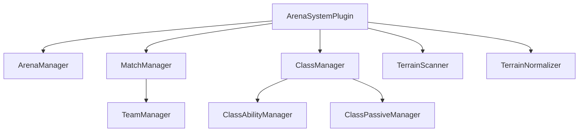

# Architecture Overview

## Component Relationships

## Data Ownership & Flow
- **Arena Data:** Managed by `ArenaGenerator` and `TerrainNormalizer`, backed by snapshots (`SnapshotStore`).
- **Match State:** Managed by `MatchState` and `MatchManager`, orchestrating team spawning and HUD rendering.
- **Player State:** Captured in `PlayerSnapshot`, tracked via `PlayerArenaListener`.
